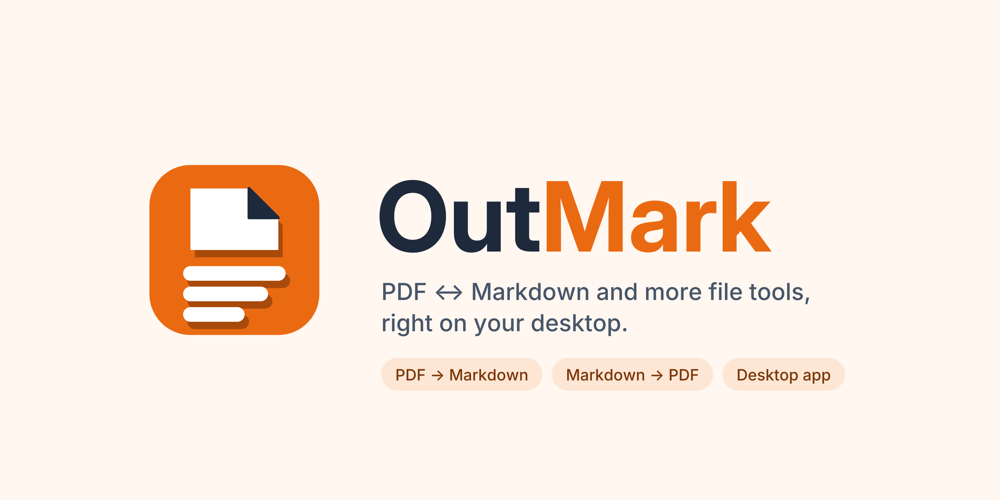
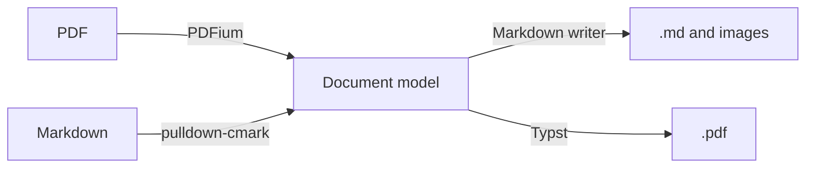

<picture>
  <source media="(prefers-color-scheme: dark)" srcset="assets/outmark-banner-dark@2x.png">
  
</picture>

<p align="center">
  <a href="https://github.com/VVF2245/outmark/actions/workflows/ci.yml"></a>
  <a href="LICENSE"></a>
  
</p>

<p align="center">
  <strong>Turn PDFs into clean Markdown, and Markdown into polished PDFs, without your files ever leaving your computer.</strong>
</p>

---

OutMark is a desktop app for people who work with notes, slides and documents. Drop in your files, choose a few options and get the result in your Downloads folder. There is no account, no upload, no network access and no telemetry.

## Download

Get the latest version from the [**Releases page**](https://github.com/VVF2245/outmark/releases/latest):

| System | File |
| --- | --- |
| **Windows** (64-bit) | `OutMark-<version>-windows-x64.zip` |
| **macOS** (Apple Silicon and Intel) | `OutMark-<version>-macos-universal.zip` |

Unzip it and follow `LEEME.txt`. There is nothing to install. The builds are not signed with a paid certificate, so your system shows a security warning the first time, and the guide explains how to continue.

The interface is in Spanish for now. You can also [build it from source](#development).

## Features

### PDF → Markdown

| You have | You get |
| --- | --- |
| **Notes, articles and books** | Headings, paragraphs, lists, code blocks and multi-column text in reading order |
| **Slide decks** | One section per slide, with its title and nested bullets |
| **Tables** | Markdown tables, with numeric columns aligned |
| **Images** | PNG files linked from the document; logos and tiny icons are filtered out |
| **Diagrams on slides** | A picture of the whole slide, so the drawing is not lost |

OutMark detects whether a PDF is a document or a slide deck, and you can always choose yourself. Repeated headers, footers and page numbers can be removed, and you can convert only a range of pages.

### Markdown → PDF

Choose the paper size, margins and font size, and get a PDF with the same typography on every computer. It supports headings, emphasis, nested and task lists, code blocks, tables, quotes, links and local images.

### Built for batches

- Convert many files at once in a single queue
- See the progress of each file and of the whole batch
- Cancel a file or a batch, and retry the ones that failed
- Copy a plain-text report of what happened
- Choose the destination folder, and jump to any result from the app
- Existing files are never overwritten

### Honest about its limits

Reading structure from a PDF is heuristic, so OutMark tells you what it could not do instead of hiding it. Each conversion comes with a report: an unclear table, skipped images, or the mode it chose.

## Current limitations

- **No OCR:** scanned or handwritten PDFs have no text to extract.
- **Formatting:** bold and italic are not kept when reading a PDF.
- **Tables:** merged cells, multi-line cells and tables that cross a page are not understood. Tables on slides stay as text, with a warning.
- **Images:** they are placed after the text of their page, not at their exact position. Some figures embedded by LaTeX are not found.
- **Columns:** Markdown has no columns, so multi-column text becomes a single column in reading order. This is checked with LaTeX and official gazette PDFs, not with Word or InDesign files.
- **Unsigned builds:** Windows and macOS show a security warning the first time you open the app.

## How it works



Every format is read into, or written from, one neutral document model, so a new format needs one reader and one writer instead of a converter for every pair. A new tool is a module registered in the engine, and the interface draws itself from the tool's description.

Built with [Tauri 2](https://tauri.app/), [Rust](https://www.rust-lang.org/), [React](https://react.dev/) and TypeScript, [PDFium](https://pdfium.googlesource.com/pdfium/) to read PDFs and an embedded [Typst](https://typst.app/) to write them.

```text
crates/core      domain: document model, Tool contract, errors, jobs (depends on nothing)
crates/engines   adapters: Markdown reader and writer, PDF reader (PDFium), PDF writer (Typst)
crates/tools     use cases (md_to_pdf, pdf_to_md) and the tool registry
src-tauri        desktop shell: Tauri commands, job queue, wiring
src              React interface, drawn from the tool descriptors
fixtures         sample documents and golden files
licenses         third-party license texts shipped with the program
scripts          get-pdfium.ps1: downloads PDFium with a pinned checksum
```

Dependencies only point one way: `core ← engines ← tools ← src-tauri`.

## Development

You need [Rust](https://rustup.rs/) (stable), [Node.js](https://nodejs.org/) and the [Tauri prerequisites](https://tauri.app/start/prerequisites/) for your platform. The PDFium script needs PowerShell: Windows includes it, and on macOS you can install it with `brew install --cask powershell`.

```bash
git clone https://github.com/VVF2245/outmark.git
cd outmark
npm install
```

Download PDFium once (the script verifies a pinned SHA-256):

```powershell
# Windows
powershell -File scripts/get-pdfium.ps1

# macOS
pwsh scripts/get-pdfium.ps1 -Platform mac-univ
```

Run the app and the tests:

```bash
npm run tauri dev
cargo test --workspace
npm test
```

`cargo test` also regenerates the TypeScript types in `src/shared/ipc/bindings/`, which are committed. Without PDFium, the tests that need it are skipped locally and fail on CI; set `PDFIUM_DIR` to use a library from another folder.

<details>
<summary>Golden files and fixtures</summary>

Expected outputs are compared exactly. After an intended change, regenerate them and review the diff:

```bash
UPDATE_GOLDEN=1 cargo test --workspace            # bash / zsh
```

```powershell
$env:UPDATE_GOLDEN = "1"; cargo test --workspace  # PowerShell
Remove-Item Env:UPDATE_GOLDEN
```

The PDFs in `fixtures/pdf/` come from the `.typ` files next to them. Edit those and run:

```bash
cargo run -p outmark-engines --example gen_fixtures
```

</details>

<details>
<summary>Release builds</summary>

The program is a folder, not a single file, because PDFium ships next to the executable. [`ci.yml`](.github/workflows/ci.yml) has the exact steps:

```bash
# Windows: builds target/release/OutMark.exe. Ship it in a folder together with
#   pdfium/win-x64/bin/pdfium.dll, LICENSE, NOTICE, licenses/ and pdfium/win-x64/LICENSE
npx tauri build --no-bundle

# macOS: the library goes inside the .app, so Tauri signs it with the rest.
#   Universal build; needs the aarch64-apple-darwin and x86_64-apple-darwin Rust targets
npx tauri build --bundles app --config src-tauri/ci/macos-pdfium.conf.json --target universal-apple-darwin
```

A tag `vX.Y.Z` builds both systems and creates a draft GitHub release, which is published by hand.

</details>

## Contributing

Issues and pull requests are welcome. Contributions are accepted under the same license as the project.

## License

Copyright (C) 2026 Luis Hernández Cuadrado. Licensed under the [GNU AGPL-3.0](LICENSE).

Third-party components keep their own licenses: see [NOTICE](NOTICE) and the [licenses](licenses) folder.
